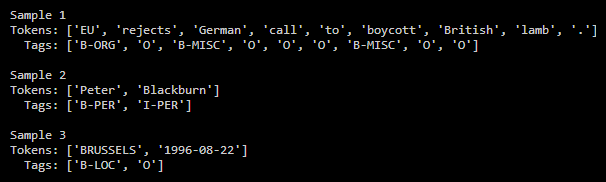
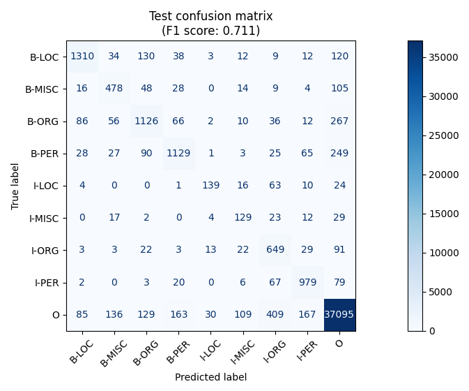
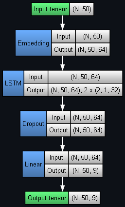

## Named Entity Recognition with a PyTorch embedding/LSTM model

Some training data samples:

	

Test set performance:

	

Model architecture (e.g. batch size = N, input sequence length in each batch = 50 tokens):

	

